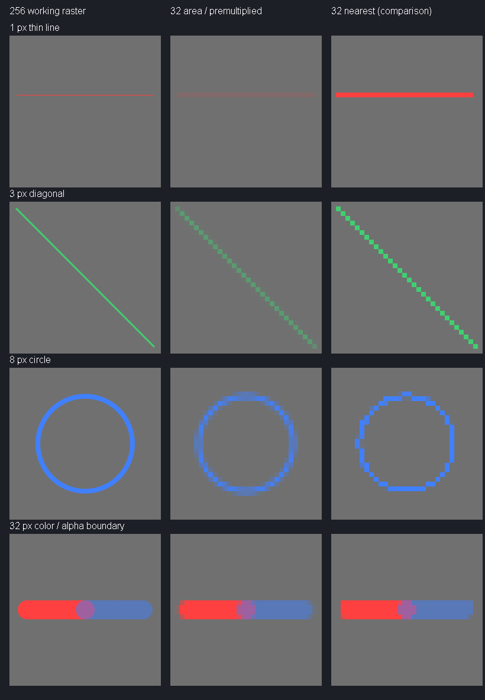

## 2026-10-24 — Phase 05B.1 正式結案（最新）

功能 Commit：`49fd5ad2ae534f7bb9524474a92318a120b69e3d`；文件結案 Commit：`c2c01e0`。使用者確認 05B.1 文件提交後工作樹乾淨。

使用者在一般 PowerShell、專案目錄 `D:\minecraftmod`，使用既有 Wrapper 實際執行 `.\gradlew.bat clean build --no-daemon`，結果為 **BUILD SUCCESSFUL**。本次依使用者提供的實際執行結果登記；未提供退出碼、耗時與任務數，不作推定。

驗收證據：無格線自由手繪、筆刷粗細與透明擦除人工 PASS；自由繪圖儲存及煙火播放人工 PASS；JUnit **84/84 PASS**；Phase 02 三組回歸 PASS；Antigravity 獨立唯讀審查 **0 Critical／0 Major／0 Minor**。以上依使用者確認記錄，本次文件更新沒有重跑遊戲、測試或審查。

**Phase 05B.1 — PASS / CLOSED**

本次僅更新階段文件；未修改 Java、測試、資源或工具鏈，未執行 Git add、commit 或 push。Phase 05B.2 尚未開始。
結案保留事項：細線縮圖後變淡、輪廓模糊，留待智慧轉換品質優化；舊Smiley與新手繪煙火夜間均偏暗，待GUI完成後調查Dust可見度；高解析度原稿只於編輯Session暫存，永久保存留待Phase 06；外部切換遊戲模式／手持物、編輯超時及其他未實測特殊場景，不宣稱人工PASS。
# Phase 05B.1 — 自由手繪驗收與固定審查交付

Status: **Phase 05B.1 PARTIAL — Waiting for successful clean build evidence**

**正式clean build尚未確認：**目前沒有實際BUILD SUCCESSFUL輸出；先前Wrapper嘗試曾在Gradle daemon連線階段失敗。直接javac及JUnitCore84/84通過不取代正式建置。

基準：`0a00372187cf172a0ab39c175acc869b7ce97e13`，開始工作樹乾淨。05A已PASS / CLOSED，本階段不重開舊結案。Codex唯一修改，沒有commit／push／暫存；交付後停止寫入供獨立唯讀審查。

## 資料架構與演算法

`FreehandInput`（原生滑鼠座標）→ `FreehandCanvas`（本次Session，最多256×256）→ 單張DynamicTexture顯示。

儲存：未改動→原始不可變CanvasData；有改動→`FreehandResampler`的8×8面積／預乘Alpha縮圖→原`EditorCanvasPayload`→原`EditSession`伺服器驗證→原ItemStack component。封包body仍最多4116bytes，沒有傳送工作原稿。

工作尺寸為輸出每維乘8；新圖輸出32×32，舊圖輸出每維1..32不變。圓形筆刷1..64工作像素、距離補點、1px邊緣覆蓋率近似；同筆最大coverage避免反覆疊色，分筆source-over、透明橡皮擦destination-out。revision驅動更新，每變動顯示幀至多一次上傳，閒置不掃描像素；關閉釋放紋理。詳見DECISIONS。

## 操作差異

| 05A | 05B.1 |
| --- | --- |
| 顯示逐格／棋盤，筆畫對齊輸出像素 | 無格線、灰色透明底，自由座標筆畫 |
| 單一像素筆與橡皮擦 | 右側共用粗細滑桿，圓形筆與透明擦除 |
| 下方工具列 | 右側8色、粗細、擦除／取消及儲存 |
| 新無component物品16×16 | 新物品32×32；既有16×16仍16×16 |
| 工作像素直接儲存 | 工作原稿轉換後儲存；底部明示完整原稿不保存 |

G、Esc、取消、伺服器確認聊天、原右鍵播放與指令維持。換色／換筆／resize會斷開舊筆畫；出界重入不畫跨區連線。沒有Undo／Redo、圖層、填色、草稿、效果預覽或新配方。

## 最短人工流程（目前全部待執行）

先在一般PowerShell完成正式建置，任何失敗先停止，不以舊JAR繼續：

```powershell
Set-Location D:\minecraftmod
$env:GRADLE_USER_HOME='D:\minecraftmod\gradle'
.\gradlew.bat clean build --no-daemon
if ($LASTEXITCODE -ne 0) { throw 'clean build failed' }
java --class-path build/classes/java/main tests/Phase02TimelineCheck.java
if ($LASTEXITCODE -ne 0) { throw 'timeline regression failed' }
java --class-path build/classes/java/main tests/Phase025DustStyleCheck.java
if ($LASTEXITCODE -ne 0) { throw 'style regression failed' }
java --class-path build/classes/java/main tests/Phase026BloomCheck.java
if ($LASTEXITCODE -ne 0) { throw 'bloom regression failed' }
.\gradlew.bat runClient
```

1. 開啟允許指令的單人Creative測試世界。`/give @s drawfirework:test_firework`取得無component新物品，主手持有後按G。確認輸出32×32、無格線、底部原稿警語完整可讀。既有`/drawfirework_test_item`給Smiley，有原尺寸，不能用它推定新空白必須32。
2. 紅色筆刷8／16快速畫斜線與圓弧，切藍色交叉，拖曳不得斷裂；試1與64確認粗細變化，橡皮擦同樣可調。畫到四邊、拖出去再進來、在外放開；確認無跨區長線、無當機、放開後移動不再畫。右鍵與工具區不得誤畫。
3. 按儲存，等待伺服器成功訊息，再G重開與右鍵播放。重開圖較低解析度是已告知限制；比較線條輪廓、紅藍色與透明區。不要期待1px工作細線與粗線等亮；記錄8／16／32筆刷的實際Dust辨識度。
4. 再G畫一筆→Esc；重開應無該筆。另測取消按鈕。只改選色／粗細、不畫便儲存，再重開，原圖應保持；重複兩次確認無累積退化。既有Smiley／已存16×16應一直維持原尺寸。
5. 切GUI Scale 2／3／Auto、調整視窗，再開編輯器；確認游標位置與筆畫對齊、圓筆不變橢圓、右側按鈕與警語不被遮蔽。重複開關20次，觀察錯誤／凍結；退出再進世界確認物品輸出仍在。完整GPU資源量測仍另記未驗證。
6. 開闊天空跑`/drawfirework heart`、`/drawfirework canvas smiley`、`/drawfirework canvas smiley dynamic`及`/drawfirework clear`；確認原動畫、固定／動態朝向、聲音、清理沒有回歸。76ticks與Bloom130／粒子預算由舊程式及回歸測試保留，視覺仍需觀察。

回報每項PASS／FAIL，包含解析度、GUI Scale、筆刷大小、物品輸出尺寸、照片／錯誤log。未修改像素的逐值相等、全部矩形尺寸與token重播已由單測涵蓋，但不能宣稱真實C2S／Screen已實機通過。05A已接受的特殊伺服器模式／換物／超時人工剩餘風險不追溯改為已測。

## 品質、效能與限制



離線PNG已檢查；細線area可連續但很淡、圓周較nearest均勻，32格階梯仍在；多色交界混色而非保持每條高解析度邊界。無黑邊證據同時由數值測試支持。不做強制不透明細線補償。

CPU診斷（30暖機／120樣本）：64筆刷長斜線p50/p95=2.120/2.863ms，縮圖0.117/0.166ms；筆畫0 bytes/op、縮圖8248 bytes/op。僅同色重複路徑的本機Java測量，不含GPU或遊戲負載，不宣稱普通整合顯示晶片操作已驗證。

尚未解決：正式Gradle建置阻塞；完整原稿不持久化；1px細節消失／變淡與32輸出限制；編碼RGB空間混色不是linear-light；Dust自身alpha及266取樣限制；GUI紋理回收、縮放、滑桿焦點與真人手感待實測；既有偶發JVM啟動閃退沒有歸因或修復。

## 精確Git暫存候選清單（20檔）

**以下是待人工驗收與審查後使用的候選清單，不表示已git add。** 修改檔包括5份原有docs、Screen、EditSession、ServerCanvasEditor、兩語系及EditSessionTest；其餘為新增。未改AGENTS、工具鏈、component／payload schema、renderer／動畫／04C播放。

```text
docs/API_COMPATIBILITY.md
docs/DECISIONS.md
docs/PHASE_05B1_ACCEPTANCE.md
docs/PROGRESS.md
docs/PROJECT_PLAN.md
docs/TEST_RESULTS.md
docs/phase05b1-quality-comparison.png
src/main/java/com/drawfirework/client/CanvasEditorScreen.java
src/main/java/com/drawfirework/client/FreehandInput.java
src/main/java/com/drawfirework/editor/EditSession.java
src/main/java/com/drawfirework/editor/FreehandCanvas.java
src/main/java/com/drawfirework/editor/FreehandResampler.java
src/main/java/com/drawfirework/network/ServerCanvasEditor.java
src/main/resources/assets/drawfirework/lang/en_us.json
src/main/resources/assets/drawfirework/lang/zh_tw.json
src/test/java/com/drawfirework/client/FreehandInputTest.java
src/test/java/com/drawfirework/editor/EditSessionTest.java
src/test/java/com/drawfirework/editor/FreehandCanvasTest.java
src/test/java/com/drawfirework/editor/FreehandPipelineTest.java
tests/Phase05B1QualityCheck.java
```

不提交build、Gradle快取、測試世界、log或舊JAR。PNG為產品演算法產生的離線審查證據，不是遊戲截圖；產生器已列入清單，可用build/classes/java/main重現。Phase05B.2／05B.3／06均未開始。
